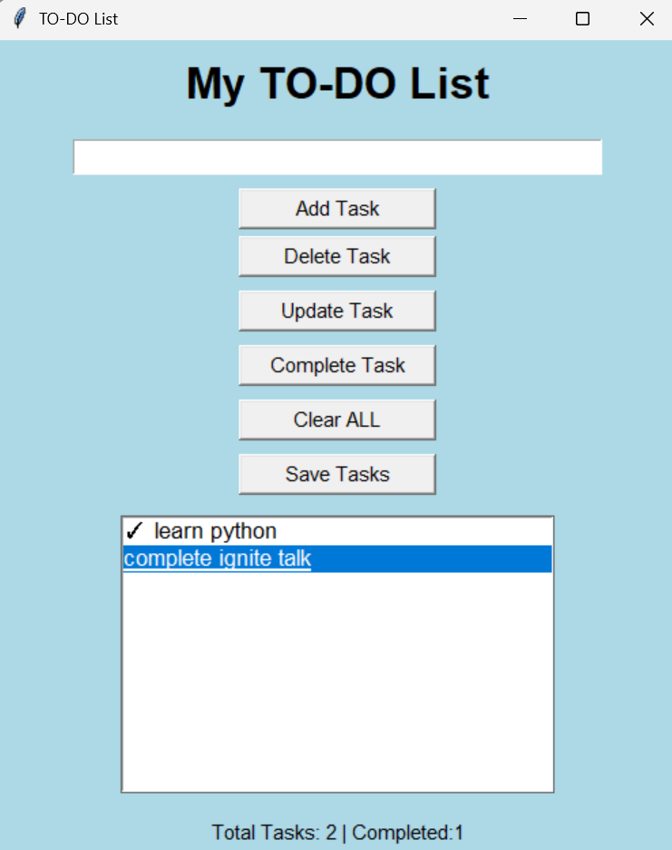
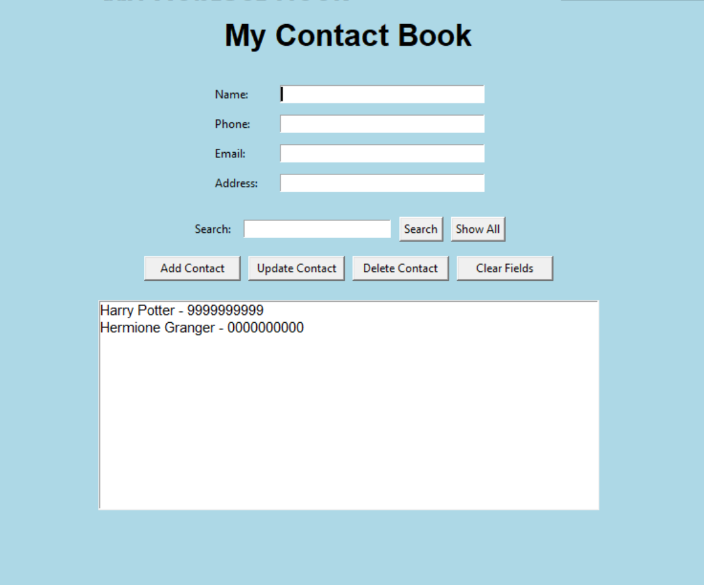

# CodeSoft Python Internship Projects

Welcome to my CodeSoft Python Internship Projects repository! This repository contains three Python projects developed as part of my internship to practice programming fundamentals, problem-solving, and application development.

---

## Task 1: To-Do List Application

### Description
A task management application developed using Python and Tkinter to help users organize their daily tasks.

### Features
- Add new tasks.
- Update and delete tasks.
- Mark tasks as completed or undo completion.
- Clear all tasks.
- Save and load tasks using JSON.
- Display total and completed task counts.

### Technologies Used
- Python
- Tkinter
- JSON

### How to Run
Run the following command in the project folder:

```bash
python todo_list.py
```

### Screenshot



**Source Code:** [todo_list.py](todo_list.py)

---

## Task 2: Simple Calculator

### Description
A menu-driven calculator developed using Python. It allows users to select an arithmetic operation, enter numbers, and view the result.

### Features
- Addition of two numbers.
- Subtraction of two numbers.
- Multiplication of two numbers.
- Division with quotient and remainder.
- Calculation of the square root of a number.
- Handles division by zero.
- Displays an error message for negative square-root inputs.
- Provides a menu option to exit the calculator.
- Handles invalid operation choices.

### Technologies Used
- Python
- Math module

### How to Run
Run the following command in the project folder:

```bash
python calculator.py
```

Choose an operation from the displayed menu and enter the requested number or numbers.

### Screenshot


**Source Code:** [calculator.py](calculator.py)

---

## Task 3: Contact Book Application

### Description
A contact management application built using Python and Tkinter. It allows users to store, search, view, update, and delete contact information through a graphical interface.

### Features
- Add contacts with name, phone number, email, and address.
- View contacts by name and phone number.
- Search contacts by name or phone number.
- Select a contact to view its complete details.
- Update existing contact information.
- Delete contacts with confirmation.
- Save contacts automatically using JSON.
- Load saved contacts when the application starts.

### Technologies Used
- Python
- Tkinter
- JSON

### How to Run
Run the following command in the project folder:

```bash
python contact_book.py
```

### Screenshot



**Source Code:** [contact_book.py](contact_book.py)

---

## About This Repository

These projects were developed as part of my CodeSoft Python Internship. Through these tasks, I practiced Python fundamentals, functions, conditional statements, loops, graphical user interfaces, and JSON file handling.

Thank you for visiting my repository!